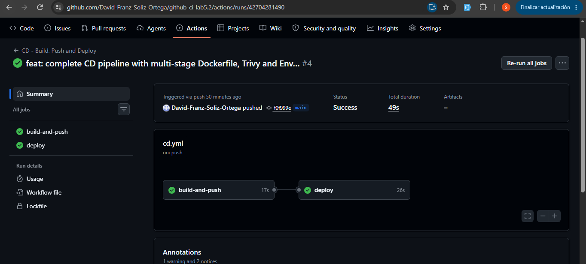

# Informe Técnico: Laboratorio 5.2-configuracion-de-un-pipeline-de-despliegue-continuo

**Universidad Mayor, Real y Pontificia de San Francisco Xavier de Chuquisaca**
**Facultad de Tecnología - Carrera de Ingeniería de Sistemas**

* **Asignatura:** Trabajando en la nube
* **Estudiante:** Soliz Ortega David Franz
* **Fecha:** 17 de Noviembre de 2026
* **Lugar:** Sucre, Bolivia
-------------------------------------------------------------------
Creamos un CRUD de peliculas

Creamos los secretos

Configuración de dockerfile

Configuracion de workflows

Subida al repositorio de github y vista de workflow

Prueba completada

Resultado de la instancia de ec2 en el navegador

Escaneo de vulnerabilidades
